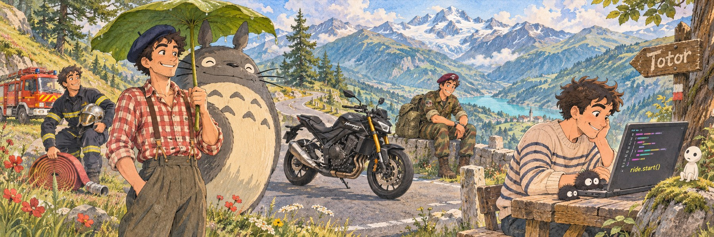

  

## Victor, alias Totor

J’ai servi trois ans au 3ᵉ RPIMa, puis trois ans chez les pompiers de Paris. Aujourd’hui, je suis sapeur-pompier volontaire et j’ai repris mes études à la Coding Factory, en développement web et cybersécurité.

### Ce que je construis

**Obsidian** est le logiciel de test d’intrusion que je développe pour les entreprises. Mon objectif est de les aider à repérer les failles de leurs systèmes et à comprendre ce qu’elles doivent corriger.

**Obsidian OS** est mon projet de système d’exploitation. Je travaille sur une première version à démarrer depuis une clé USB.

**Kurw** est né d’une question que je me pose au guidon de ma Hornet 750. Quand j’ai deux heures pour rouler, quelle boucle prendre et qui veut venir ? J’ai développé l’appli en Flutter pour choisir une balade selon le temps disponible et proposer à d’autres motards de la rejoindre.

Je cherche une **alternance de deux ans en cybersécurité** à partir de septembre 2027, autour de Cergy, Paris ou Rouen.
